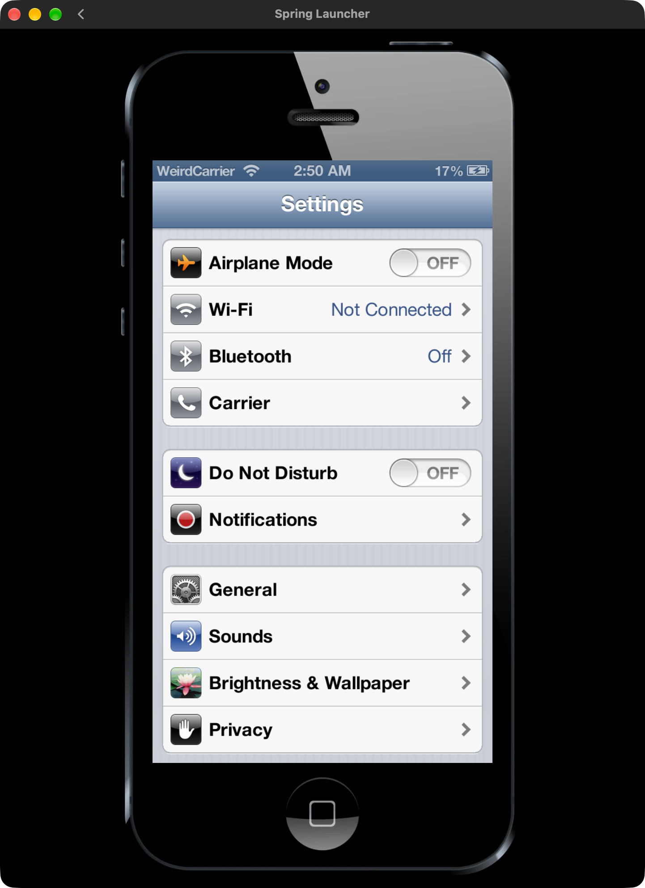

# WinterX


WinterX is WeirdMM's fan-made jailbreak and tweak project for **Spring**, the iOS-style Android simulation. Ruby is its experimental package manager. This is a beta made for fun; it is not an iOS jailbreak and is not affiliated with Spring, Apple, or Cydia.



## Current status

- **Mac.APK:** experimental source build for the specific Spring 0.8.1 APK below. The jailbreak uses a local Mac bridge and a patched launcher. Ruby can manage supported packages; several features are still in development.
- **Executable `.springys/2` tweaks:** independently authored JavaScript can add native Spring Settings pages, actions, toggles, scoped storage and alerts. Basic execution and callbacks were live-confirmed on Mac.APK. This is not a general home-screen hooking API or a hardened sandbox; runtime limits and recovery still need live checks.
- **Rooted Android and emulators:** **not supported yet**. There is no working Android installer, root service, or LAN bridge in this version. The patched APK produced here is unsigned and intended for Mac.APK; do not install it as an Android update. Root access alone does not make this release compatible. Android support and a tested installation guide are planned.
- **Built-in tweak repository:** includes **Animaper and ColoredBar**. ColoredBar has presets, exact RGB colours and app exclusions in Spring Settings. Updated engines keep Ruby's own red navigation and bottom tabs, even without tweaks or in Safe Mode. SnowyHome, SSH, FreeMe and DockIn are unfinished and are not published as working tweaks.
- **Layout development:** [FreeMe and DockIn](docs/layout-tweaks.md) have packaged native-grid/dock/Settings, cache-preserving motion, launch-size and Canvas-exception checks. **Alpha8-local is prepared, not automatically launched or installed**; complete native pointer/folder and rendered-motion trials remain required. Both drafts stay outside the working catalogue. See [development status](docs/development-status.md).
- **Portable bridge progress:** bounded directory/ADB/SSH-client transfers, recovery journals and Ruby inventory/repository requests are implemented in source. This is not an Android jailbreak/installer or the on-device SSH tweak. Tweak install/remove requests fail closed until Android running-engine and reconciliation support exists. No server or network connection was started during development.
- **Ruby 1.8:** includes **Join our Discord** on its home page: [WinterX community](https://discord.gg/4JTe27ZRNd). Tapping uses Spring's confirmation before opening Safari; nothing opens automatically. This app requires the updated engine's trusted-script pin.
- **WinterX companion 0.6:** displays only supported Spring **0.8.1**, with no preview selector. Its app description links this repository and explains the required bridge/local engine.

No Spring APK, Spring SDK, Mac.APK, built binaries, personal app data, or third-party artwork is distributed here. Get the original Spring and SDK from their respective distributors. Spring: [spring.elguille.me](https://spring.elguille.me/).

## Install on Mac.APK (build from source)

This is an advanced, experimental setup. Back up your Spring data before proceeding. You need several GB free and exactly one Spring Launcher window when jailbreaking. The scripts currently expect an Apple Silicon Mac, Mac.APK at `/Applications/Mac.apk.app`, and the Spring Launcher app at `/Applications/Spring-Launcher.app`. Other installations may need code changes.

### 1. Prepare dependencies

Install Git, Python 3, Node.js (for UI tests), Homebrew `apktool` and `openjdk`, Android SDK Build Tools **36.0.0**, and Mac.APK with Spring 0.8.1 already installed. Install Android command-line tools separately and run `sdkmanager 'build-tools;36.0.0'`. The current builder looks for D8 under `~/Library/Android/sdk/build-tools/36.0.0/lib/d8.jar` and Java under `/opt/homebrew/opt/openjdk/bin/`. It uses Mac.APK's local framework and runtime. For the Homebrew dependencies:

```sh
brew install apktool openjdk
```

Clone the project, put the **original, unmodified** Spring 0.8.1 APK in the checkout as `Spring-0.8.1.apk`, and unpack the Spring SDK as `SpringSDK-r10/` so that `SpringSDK-r10/tools/spring_pack.py` exists:

```sh
gh repo clone UltraFEmotes/WinterX
cd WinterX
shasum -a 256 Spring-0.8.1.apk
```

The supported APK's SHA-256 must be `f07f980fe681a6de9c4ce8735ae1c0bb0f852f447fbdb925d2dec37cf9778e5c`. Preview and other Spring versions are not supported. The installed Spring APK must match too.

Set up the Python dependency used for package artwork and the color test:

```sh
python3 -m venv .venv
. .venv/bin/activate
python -m pip install Pillow
```

### 2. Build the local launcher and apps

```sh
mkdir -p builds
python tools/generate_theme.py Spring-0.8.1.apk
WINTERX_BUILD_ANIMAPER=1 WINTERX_BUILD_TRUSTED_FILES=1 WINTERX_BUILD_INBOX=1 \
  python patches/icon_positions/build.py Spring-0.8.1.apk builds/WinterXSpring-local.apk
python tools/configure_build.py builds/WinterXSpring-local.apk
python SpringSDK-r10/tools/spring_pack.py pack RubyJailbreak -o builds/WinterX.sapp
python SpringSDK-r10/tools/spring_pack.py pack Ruby -o builds/Ruby.sapp
```

The generated theme uses resources from your own APK and stays on your machine. The build refuses to overwrite an existing output. The local configuration records the build's SHA-256, which the bridge checks before launching it.

The builder decodes only bytecode/metadata instead of duplicating Spring's large asset library. Final assembly verifies stock resources remain unchanged apart from WinterX's boot images. This reduces temporary disk use without removing assets from the finished launcher.

### 3. Install the apps in Spring

Enable Spring's sideloading/developer mode if needed. Copy both apps into the Spring inbox:

```sh
INBOX="$HOME/Library/Application Support/MacApk/com.guille.spring/sdcard/Android/data/com.guille.spring/files/sapps-inbox"
mkdir -p "$INBOX"
cp builds/WinterX.sapp builds/Ruby.sapp "$INBOX/"
```

Fully quit **Spring Launcher** and reopen it so stock Spring imports the apps. Reopening only the app inside Spring is not enough.

### 4. Jailbreak

With the virtual environment active, run the bridge in a terminal and leave it running:

```sh
python tools/ruby_bridge.py
```

Open the original Spring Launcher, open **WinterX**, and tap **Jailbreak**. The bridge checks the original and patched APKs, backs up app data, and starts the patched launcher. Ruby should be available after Spring starts. Some local features work without the bridge, but jailbreak and parts of package management still require it. On Mac.APK, a respring can leave Spring stuck on its loading screen: fully quit and reopen the launcher when needed.

**Updating:** do not replace an engine APK in use. Keep the old APK and data backup, fully quit Spring, build to a new filename, configure that file, then deliberately reopen the launcher. Engine changes and newly installed/updated executable tweaks require a full launcher reopen. A v2 install reports staging, not successful execution, and does not automatically restart Spring. Native ColoredBar/Animaper marker changes do not need a respring on compatible engines. Never run stock and patched Spring simultaneously.

## Safe Mode and recovery

Ruby can enter Safe Mode to temporarily disable tweaks. If Spring cannot start, fully close Spring Launcher, activate the virtual environment, run `python tools/prepare_safe_mode.py`, then start the original launcher, start the bridge and jailbreak again. Safe Mode is experimental. Backups made by the bridge are stored under the checkout's `.ruby-state/backups/`; preserve them if recovering data.

## For developers

Run `python3 tools/check_source_tests.py` for the explicitly fixture-independent Python suite (108 passing tests), plus the four JavaScript smoke runners in the [testing guide](docs/testing-winterx.md). Full development discovery passed 116 tests where local SDK/APK/theme inputs exist; a source-only checkout does not include those inputs.

- [Make a `.springys` package: tutorial, artwork, updates and format reference](docs/springys-format.md)
- [Creating an experimental Ruby repository](docs/repository-design.md)
- [Executable-tweak runtime and supported API](docs/tweak-runtime-design.md)
- [ColoredBar preferences, coverage and Ruby branding](docs/coloredbar.md)
- [Testing and recovery](docs/testing-winterx.md) · [Release checklist](docs/release-checklist.md)
- [Windows/Linux and Android bridge development](docs/android-bridge.md) — inventory/repositories, bounded transports and host recovery exist; Android engine deployment/tweak reconciliation and real-platform validation are not ready.
- Source is in `patches/`, `tools/`, `Ruby/`, `RubyJailbreak/`, and `IExplored/`. The [built-in repository](https://github.com/UltraFEmotes/Ruby-Repo) contains Animaper and ColoredBar. Developer examples remain source-only, outside its index.

A v1 `.springys` archive selects a compiled hook. A v2 archive contains its author's `tweak/main.js`, runs in a separate QuickJS worker and uses the documented WinterX API. The actual runtime/Settings, registry/bridge, QuickJS bootstrap and authoring example are published here—not only a format proposal. Java/reflection, shell execution, networking, arbitrary home-icon mutation and custom animation hooks are not exposed to tweak code. Repository downloads use HTTPS and verify package hashes, but a matching hash does not make a source trustworthy. Install executable tweaks only from authors you trust.

With the SDK, APK, generated theme, and Pillow in place, run `python -m unittest discover -s tests -q`. JavaScript checks include `node tests/ruby_ui_smoke.js` and `node tests/tweak_runtime_smoke.js`. Packaged-helper checks are listed in the testing guide. Node and JVM-spy checks do not replace native QuickJS or live UI testing. Ruby's new red bars/Discord button and the Settings/App Store coverage fixes still need a user trial; earlier basic ColoredBar and executable-example behaviour were live-confirmed.

## License

Original WinterX code and project-created artwork are under the [MIT License](LICENSE). Spring, Mac.APK, their artwork, trademarks, and the Spring screenshot belong to their respective owners and are not relicensed here.
