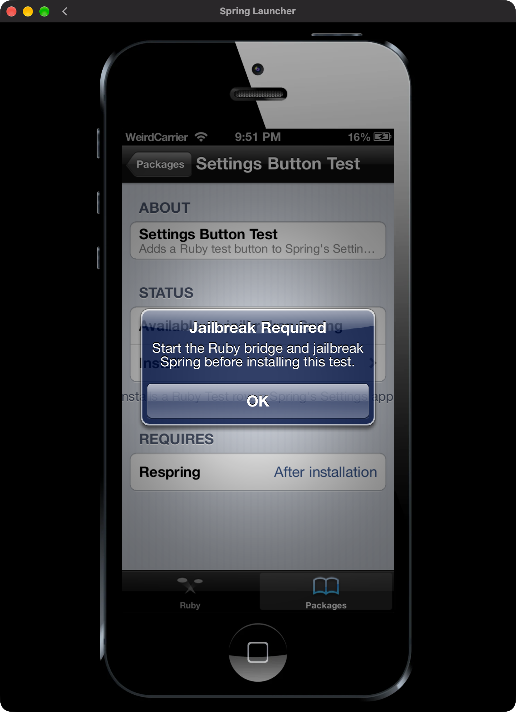

# WinterX & Ruby

WinterX is a fan-made project by WeirdMM for [Spring](https://spring.elguille.me), the iOS-style Android simulator. Ruby is its iOS 6-inspired package manager. This is a fun project built for experimenting with Spring and sharing tweaks with its community.




WinterX targets **Spring 0.8.1**. Its new core contains generic hooks and loaders; tweaks are independently installed **Java/Dex or JavaScript code packages**. **Fresh installations include no tweaks.** Animaper and the other installed tweaks share **Settings → WINTERX TWEAKS**, while Ruby keeps its own red bars independently.

The rooted workflow preserves Spring's original APK and app identity. Live testing uses an **Android 10 ARM64 emulator on macOS**; physical devices, other platforms and rootless support are not established by that test. See [development status](docs/development-status.md). Message+ video sending and reactions remain unfinished.

## Try the development build

1. [Build the core and apps locally](docs/native-packages.md) using your separately obtained Spring APK/SDK.
2. Follow the [rooted Android/emulator setup](docs/rooted-android.md) or [Mac.APK core workflow](docs/native-packages.md#macapk-core-workflow).
3. Install Ruby and WinterX through Spring's Developer Mode/inbox importer.
4. In Ruby, refresh Sources and install the code packages you want. Wait for the result, then fully reopen Spring through WinterX to load them.

Packages: [Animaper](docs/animaper.md), [ColoredBar](docs/coloredbar.md), [FreeMe and DockIn](docs/layout-tweaks.md), [SnowyHome](docs/snowyhome.md), [Message+](docs/messageplus.md), and [SSH](docs/ssh.md). SSH starts only through its explicit Settings control.

Spring itself and its APK are not part of WinterX. Ruby and WinterX are independent fan projects and are not affiliated with Spring, Apple, or Cydia.

## Developers

- **[Making WinterX tweaks](docs/making-tweaks.md)**: tutorial and full reference (manifest, Java API, every hook point, Settings pages, publishing)
- [Build a `.springys` package](docs/springys-format.md)
- [Create a repository](docs/repository-design.md)
- [WinterX testing and recovery](docs/testing-winterx.md)
- [Built-in repository development](builtin-repo/README.md)
- [Actual executable-tweak implementation and API](docs/tweak-runtime-design.md)
- [Native code packages and public hooks](docs/native-packages.md) · [Standalone community example](examples/native-hello/)
- [FreeMe and DockIn](docs/layout-tweaks.md) · [Portable bridge/SSH-client development](docs/android-bridge.md)

Check and build the Ruby app with Spring SDK r10:

```sh
python3 SpringSDK-r10/tools/spring_pack.py check Ruby
python3 tools/build_sapp.py Ruby out/Ruby.sapp
python3 -m unittest discover -s tests -q
node tests/ruby_ui_smoke.js
```

Reviewed source/docs are published separately. Third-party Spring assets, the Spring APK/SDK, private app data and build outputs are excluded; third-party artwork must not be assumed to be covered by the project source license.

## License

Original WinterX and Ruby project code is available under the [MIT License](LICENSE). Third-party software, artwork, trademarks, and Spring screenshots retain their respective owners' rights and are not relicensed by that license. The Spring APK and SDK are excluded from the source repository.
